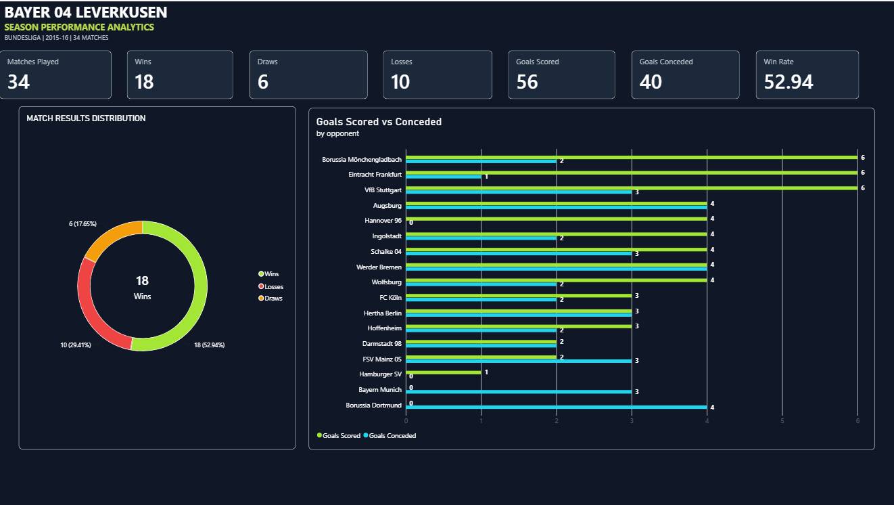
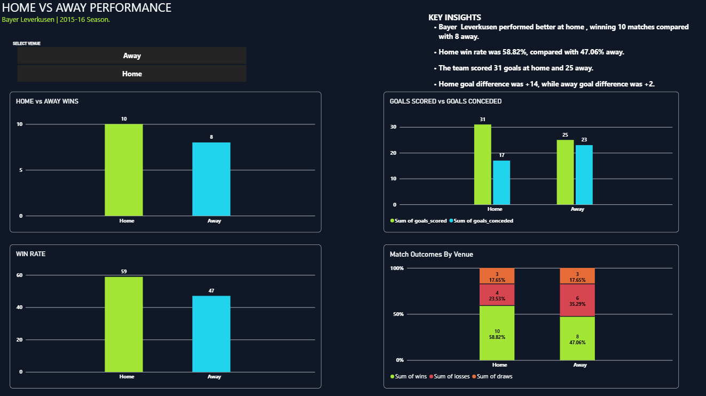
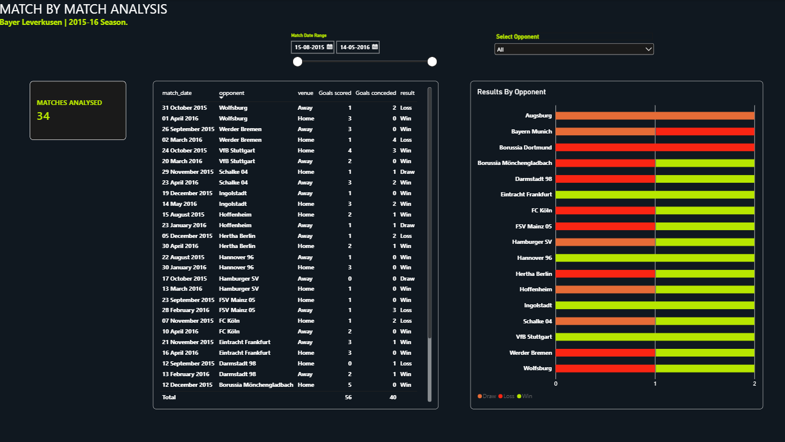

# Football Intelligence & Performance Analysis

An end-to-end football data analytics project exploring Bayer 04
Leverkusen's 2015--16 Bundesliga match performance using Python,
PostgreSQL, and Power BI.

> **Dataset scope:** This analysis uses 34 StatsBomb match records
> featuring Bayer 04 Leverkusen. It is a focused analysis of Bayer
> Leverkusen's fixtures, not a complete dataset of all 306 Bundesliga
> matches. Statistics shown for other teams are limited to their
> appearances in these 34 matches.

## Project objectives

-   Clean and structure raw football match data.
-   Store related match, team, and manager information in a relational
    database.
-   Use SQL to analyse results, goals, and home/away performance.
-   Present findings in an interactive Power BI dashboard.

## Tools and technologies

-   **Python 3.10** and **pandas** --- data extraction and cleaning
-   **PostgreSQL** and **pgAdmin 4** --- database management and SQL
    analysis
-   **Power BI Desktop** --- interactive dashboards
-   **StatsBomb Open Data** --- source football data

## Project structure

``` text
Football_Analytics/
├── Dataset/
│   ├── clean_matches.csv
│   ├── team_details.csv
│   ├── manager_details.csv
│   └── match_team_managers.csv
├── Python/
│   └── data_cleaning.py
├── SQL/
│   └── football_analysis_queries.sql
├── PowerBI/
│   └── Bayer_Leverkusen_Analytics.pbix
├── Screenshots/
│   ├── 01_Season_Overview.png
│   ├── 02_Home_Away_Analysis.png
│   └── 03_Match_Analysis.png
└── README.md
```

## Data preparation

The original StatsBomb match data was provided in JSON format. Python
and pandas were used to extract relevant fields and create four
structured CSV datasets.

  ------------------------------------------------------------------------------
  File                        Description                                Records
  --------------------------- --------------------- ----------------------------
  `clean_matches.csv`         Match dates, teams,                             34
                              scores and match      
                              details               

  `team_details.csv`          Team identifiers,                               18
                              names and countries   

  `manager_details.csv`       Manager identifiers                             23
                              and details           

  `match_team_managers.csv`   Match-team-manager                              68
                              relationships         
  ------------------------------------------------------------------------------

The CSV files were imported into PostgreSQL. Primary keys and
foreign-key relationships were used to maintain consistency between the
tables.

## SQL analysis

SQL queries and reusable views were created to examine:

-   Bayer Leverkusen's wins, draws and losses
-   Win percentage
-   Home and away performance
-   Goals scored and conceded
-   Goal difference
-   Match-by-match results against opponents

## Key findings

Across the 34 Bayer Leverkusen matches in this dataset:

  Metric               Result
  ------------------ --------
  Matches analysed         34
  Wins                     18
  Draws                     6
  Losses                   10
  Win percentage       52.94%
  Goals scored             56
  Goals conceded           40
  Goal difference         +16

### Home and away comparison

  Venue     Matches   Wins   Goals scored   Goals conceded
  ------- --------- ------ -------------- ----------------
  Home           17     10             31               17
  Away           17      8             25               23

Bayer Leverkusen recorded more wins at home than away in this dataset.
The team also scored more goals and conceded fewer goals in its home
matches.

Across all 34 fixtures, both teams combined scored 96 goals, averaging
2.82 goals per match. This is a fixture-level total, not Bayer
Leverkusen's goals total.

## Power BI dashboard

The report contains three analysis pages:

1.  **Season Overview** --- key performance indicators and overall
    results.
2.  **Home vs Away Analysis** --- comparison of performance by venue.
3.  **Match-by-Match Analysis** --- match results and opponent-level
    exploration.

The report includes interactive filters to explore the match data.

## How to explore the project

1.  Review the cleaned CSV files in `Dataset/`.
2.  Open `Python/data_cleaning.py` to review the data preparation
    process.
3.  Run the SQL statements in `SQL/football_analysis_queries.sql` after
    importing the CSV files into PostgreSQL and creating the required
    tables.
4.  Open `PowerBI/Bayer_Leverkusen_Analytics.pbix` in Power BI Desktop
    to explore the dashboard.

## Data source

StatsBomb Open Data: https://github.com/statsbomb/open-data

Please consult the source repository for attribution and usage details.

## Disclaimer

This is an independent portfolio project for learning and demonstrating
data analytics skills. The analysis is limited to the 34 Bayer
Leverkusen fixtures included in the selected StatsBomb dataset. It
should not be interpreted as complete Bundesliga season statistics for
every club.

## Dashboard Preview

### 1. Season Overview


### 2. Home vs Away Analysis


### 3. Match Analysis

